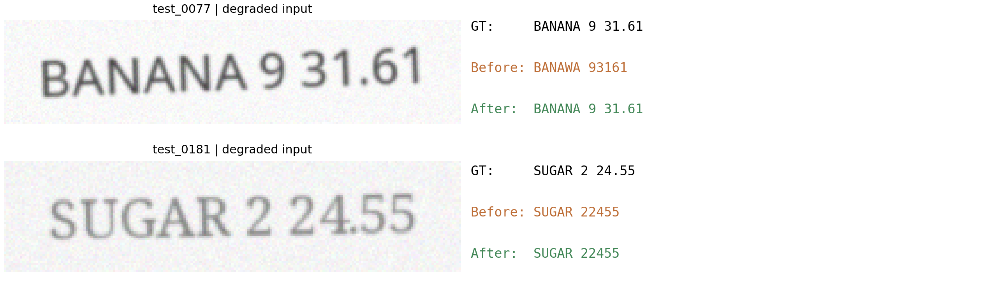
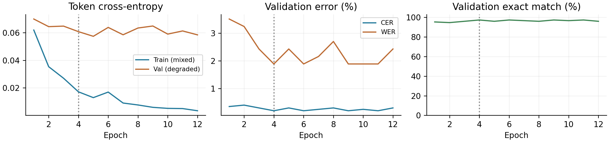
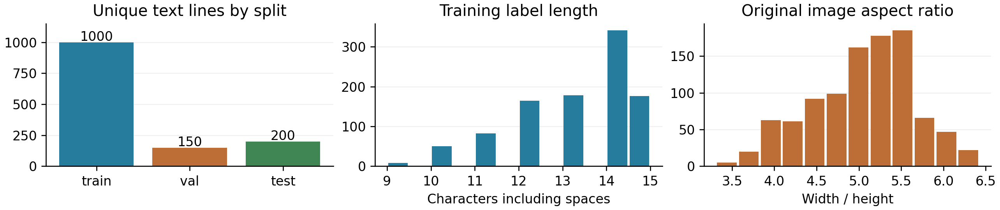
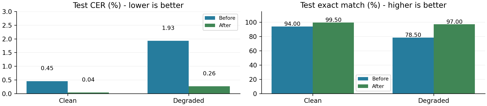

# TrOCR 영수증 한 줄 OCR 실험

7주차 OCR 학습 내용을 적용해 **합성 영문 영수증 한 줄의 인식**을 실험했다. Runpod NVIDIA A40에서 `microsoft/trocr-small-printed`의 이미지 인코더를 고정하고 텍스트 디코더를 12 epoch 학습했다.

실촬영 영수증이나 전체 문서 OCR의 성능을 측정한 실험은 아니다. 글자 검출, 줄 분리, 한글 인식, 표·레이아웃 분석은 포함하지 않는다.

## 핵심 결과

검증 열화 영상의 CER가 가장 낮은 **epoch 4** 모델을 선택했다. CER 동률이면 먼저 도달한 모델을 유지했다. 테스트 200문장 각각의 깨끗한 영상과 열화 영상에서 학습 전후를 비교했다.

| 입력 | CER ↓ | WER ↓ | 한 줄 완전 일치율 ↑ |
|---|---:|---:|---:|
| clean | 0.454% → 0.038% | 4.357% → 0.415% | 94.0% → 99.5% |
| degraded | 1.930% → 0.265% | 15.975% → 1.867% | 78.5% → 97.0% |

열화 테스트의 문자 오류는 **51/2643 → 7/2643**, 완전히 맞힌 문장은 **157/200 → 194/200**이었다. 낮은 평균 CER에도 소수점·공백이 빠진 오류가 남는다.




## 데이터 구성과 평가 범위

- Noto Sans·Noto Sans Mono·Noto Serif로 상품·금액·날짜·영수증 번호를 합성했다. 실제 고객 정보는 없다.
- 문자열 1,350개: train 1,000 / validation 150 / test 200. seed 42. **완전히 같은 문자열의 분할 간 중복은 0**이다.
- 각 문자열에 원본·열화 PNG를 만들어 총 2,700장이다. 훈련에는 원본 500장과 열화 500장만 사용했다. 검증은 열화 150장, 최종 테스트는 같은 200문장의 두 조건이다.
- 회전 U[-4,4]도, Gaussian blur radius U[0.4,1.0], 대비 U[0.45,0.75], Gaussian noise sd=5를 함께 적용했다. 복합 열화의 결과이며 각 요인의 개별 효과를 분리하지 않았다.
- 모든 분할이 같은 세 글꼴과 문법을 공유한다. 이 평가는 낯선 글꼴·업체·현실 촬영 환경에 대한 독립 검증을 대신하지 않는다. 원본·열화 쌍을 독립 표본 400개로 계산하지 않는다.




`data/receipt_lines.zip`에는 **실험에 실제 사용한 고정 PNG**가 있다. `data/manifest.json`은 정답과 분할·열화값, `data/image_sha256.json`은 2,700장 각각의 해시다. `prepare_data.py`는 기본적으로 이 파일들을 추출·검증한다. 생성 로직도 공개했지만 글꼴 래스터라이저 버전이 다르면 재생성 픽셀이 달라질 수 있다.

최초 생성 환경: Python 3.12, Pillow 12.3.0, NumPy 2.3.5, FreeType 2.14.3. GPU에서 이미지를 읽고 전처리한 환경은 아래와 다르므로 고정 PNG와 해시를 기준으로 재현한다.

## 모델과 학습 설정

| 항목 | 실제 실행값 |
|---|---|
| 모델 | `microsoft/trocr-small-printed` (SROIE fine-tuned checkpoint) |
| revision | `04e994ab854b0089d4929f48c2b4dbe2ce78a340` |
| 입력 | RGB → checkpoint processor → 384×384 |
| 학습 범위 | 디코더 39,636,480 / 전체 61,596,672 파라미터 |
| 인코더 | 고정, 특징을 한 번 계산해 캐시 |
| 학습 | 12 epoch, batch 16, AdamW lr 2e-5, weight decay 0.01 |
| 계산 | bf16 autocast, gradient norm clip 1.0 |
| 손실 | 정렬한 토큰의 교차엔트로피, pad는 -100으로 제외 |
| 디코딩 | greedy, num_beams=1, do_sample=False, max_new_tokens=47 |
| 선택 | 검증 CER 최저, 동률은 최초 epoch |
| 학습 시간 | 49.13초 (epoch별 검증 포함, 설치·다운로드·인코딩 제외) |
| 인코딩 시간 | 9.45초 |
| 환경 | A40, Python 3.12.3, torch 2.9.1+cu128, transformers 4.57.1 |

학습 손실은 패딩을 제외한 배치 토큰 평균을 샘플 수로 가중한 값이다. 훈련은 혼합 영상, 검증은 열화 영상이므로 두 손실의 절대 크기를 직접 비교하지 않는다. 후반의 손실 감소가 더 낮은 검증 CER로 이어지지는 않았다.

### 토큰 정렬과 초기 점검

이 체크포인트는 decoder start ID가 **2(EOS)**다. 토크나이저가 붙인 BOS는 정답에서 제거하고, EOS로 시작한 decoder input을 오른쪽으로 한 번 이동시킨다. `labels` 인수를 모델에 넘기지 않고 logits와 정답의 교차엔트로피를 명시적으로 계산했다.

초기 환경 점검에서 Transformers 4.57.1의 기본 causal loss 경로가 이미 정렬된 seq2seq 목표를 다시 이동시키는 문제가 확인됐다. 한 훈련 샘플에서 생성 토큰은 정답과 같지만 기본 loss가 크게 나오는 것을 대조해 발견했다. 초기 실행은 최종 실험에서 제외하고, 원래 사전학습 가중치를 다시 로드해 전체 실험을 재실행했다. 초기 테스트 지표를 보고 하이퍼파라미터를 탐색하지 않았다. 최종 12 epoch의 lr·데이터 분할·디코딩 조건은 고정했다.

인코더 pooler 미초기화 경고는 사용할 일이 없는 pooling head다. 실제 사용한 `last_hidden_state`와는 구분한다. 캐시 계산 후 고정 인코더를 훈련하지 않았다.

### CER와 WER

- CER = 전체 문자 Levenshtein 편집거리 합 / 전체 정답 문자 수.
- WER = 공백으로 나눈 단어의 편집거리 합 / 전체 정답 단어 수.
- 완전 일치율 = 정답 문자열과 같은 문장의 비율.
- 대소문자와 숫자·구두점을 구분한다. 앞뒤 공백 제거 및 연속 공백 축약만 적용한다. 문장별 CER의 단순평균을 사용하지 않는다.
- `decoder_eval_s`는 캐시된 특징에서 teacher-forced 손실과 텍스트 생성까지 측정한 배치 처리 시간이다. 이미지 인코딩·네트워크·문서 검출을 포함한 운영 지연으로 해석하지 않는다.

CRNN은 CNN + BiLSTM + CTC 구조이며, CTC는 인접 중복을 합친 뒤 blank를 제거한다. blank로 구분된 반복 글자는 유지한다. **이번 TrOCR는 autoregressive Transformer로 CTC를 사용하지 않는다.**

## 재현

CUDA GPU가 있는 Linux 환경에서 실행한다. 메모리는 캐시와 배치 설정에 따라 달라지며 이번 실행은 A40 48GB를 사용했다. 사전학습 모델과 데이터 해시는 저장소에 고정했다. GPU 커널의 비결정적 동작에 따라 최종 수치가 약간 달라질 수 있다.

```bash
# Runpod의 새 실험용 컨테이너에서 실행한 설치 방식
python -m pip install --break-system-packages -r requirements.txt
export VISIONAI_ROOT="$PWD"
python experiments/prepare_data.py
python -u experiments/gpu_experiment.py | tee experiment.log
python experiments/make_figures.py
```

`--break-system-packages`는 이번 실험용 일회성 컨테이너 설치에 사용했다. 일반 로컬 환경에서는 가상환경을 사용한다. `best_decoder.pt`는 실행 시 생성되며 저장소에는 가중치를 포함하지 않았다. 모델 전체는 지정 revision에서 내려받는다.

### 로컬에서 Runpod API로 제어

```bash
mkdir -p .private
chmod 700 .private
ssh-keygen -t ed25519 -f .private/visionai_runpod -N ''
# RUNPOD_API_KEY를 로컬 환경변수로 설정한 뒤 실행한다.
python experiments/runpod_control.py create
python experiments/runpod_control.py status
# 90분 제한 watchdog. 로컬 프로세스가 유지되는 동안만 작동한다.
python experiments/runpod_control.py watchdog > .private/watchdog.log 2>&1 &
```

API 응답에 표시된 Pod IP와 매핑된 SSH 포트로 연결한다. `.private/`, API 키, 개인 SSH 키를 서버로 복사하지 않는다. 전송 묶음에는 공개 데이터와 실험 코드만 넣는다.

```bash
tar -czf /tmp/ocr-input.tar.gz experiments data requirements.txt model_metadata.json
# scp -i .private/visionai_runpod -P <SSH_PORT> /tmp/ocr-input.tar.gz root@<POD_IP>:/workspace/
# Pod: mkdir -p /workspace/visionai_week7
# Pod: tar -xzf /workspace/ocr-input.tar.gz -C /workspace/visionai_week7
# Pod: cd /workspace/visionai_week7 후 위 재현 명령을 실행한다.
# 결과를 로컬로 회수한 후 종료한다.
python experiments/runpod_control.py delete
```

클라이언트는 새 Pod 시간당 가격이 1.50달러를 넘으면 삭제하고, 이 실험의 기존 5달러 예산 아래에 있도록 90분 제한을 둔다. 자동 삭제를 보장하는 클라우드 예약 작업은 아니므로 로컬 프로세스 종료 시 직접 삭제해야 한다. 이번 실제 실행은 **삭제 후 GET 404까지 확인**했다. 환경 점검과 진단을 포함한 견적 비용은 **약 0.076달러**이며 최종 청구서 금액은 아니다.

## 파일

- `experiments/gpu_experiment.py`: 특징 캐시, 손실 정렬, 학습·검증·평가.
- `experiments/prepare_data.py`: 고정 PNG 추출/해시 검증, 합성 데이터 생성 코드.
- `experiments/make_figures.py`: 결과 JSON/CSV에서 도표 재생성.
- `experiments/runpod_control.py`: 환경변수 인증, Pod 생성·확인·삭제·watchdog.
- `results/*_records.json`: 문장별 정답·예측, `*_metrics.json`: 집계값, `history.csv`: 실제 12 epoch.
- `results/environment.json`, `runpod_usage.json`: 버전·실행 조건·비용 추정.

보고서 원본, 학번 등 제출용 개인정보, API 키, 접속 상태 파일은 공개 저장소에 포함하지 않았다.

## 출처와 사용 조건

- [TrOCR 모델 카드](https://huggingface.co/microsoft/trocr-small-printed): 영문 인쇄체 한 줄 OCR. 카드에 별도의 라이선스 태그는 없다.
- [TrOCR 논문](https://arxiv.org/abs/2109.10282), [Microsoft UniLM 공식 구현](https://github.com/microsoft/unilm/tree/master/trocr), [UniLM MIT LICENSE](https://github.com/microsoft/unilm/blob/master/LICENSE): 저장소의 MIT 표기와 모델 카드의 표시 범위를 구분한다.
- [Transformers TrOCR 문서](https://huggingface.co/docs/transformers/model_doc/trocr): 이미지·문자 Transformer 구조.
- [Noto Sans](https://github.com/google/fonts/tree/main/ofl/notosans), [Noto Sans Mono](https://github.com/google/fonts/tree/main/ofl/notosansmono), [Noto Serif](https://github.com/google/fonts/tree/main/ofl/notoserif): 폰트 파일·원출처·각 OFL 문서를 `data/fonts/`에 포함했다.
- [Runpod Pod REST API](https://docs.runpod.io/api-reference/pods/POST/pods).

학습 개념은 제공된 7주차 OCR 수업자료를 참고했다. 해당 자료와 개인 강의 텍스트는 재배포하지 않았다.
